# Technology Layoffs Analysis

An exploratory data analysis project investigating global technology layoffs using Python, Pandas, NumPy, Matplotlib, and Seaborn.

Technology companies across the world have experienced significant workforce reductions in recent years. This project analyzes recorded technology layoffs to understand trends across years, industries, companies, countries, company stages, and funding levels.

### Highlights

- **2023 was the peak year:** 264,660 employees were laid off in records with a known count; 1,389 layoff events were recorded in total.
- **United States:** Accounted for approximately 70.9% of all known recorded layoffs.
- **2026:** Recorded 144,171 known layoffs through November 11, already 17.6% higher than the 122,606 recorded during the full year 2025. 2026 is a partial year.

## Project Overview

The project uses a cleaned dataset containing **4,670 records from March 2020 to November 2026**, originally sourced from Layoffs.fyi and obtained through Kaggle.

The analysis includes data cleaning, exploratory data analysis, statistical analysis, and 15 visualizations.

## Project Objectives

- Analyze global technology layoff trends over time.
- Identify the industries and companies with the highest recorded layoffs.
- Compare layoffs across countries and company funding stages.
- Examine the distribution and scale of layoffs.
- Investigate the relationship between company funding and layoffs.
- Explore monthly layoff patterns.
- Communicate findings through clear visualizations and statistical insights.

## Dataset

**Dataset:** [Layoffs Dataset – Kaggle](https://www.kaggle.com/datasets/swaptr/layoffs-2022)

**Original data source:** [Layoffs.fyi](https://layoffs.fyi/)

- Original records: 4,675
- Cleaned records: 4,670
- Date range: March 2020 – November 2026
- Coverage: Global technology company layoff events

The dataset includes:

- Company
- Location
- Country
- Industry
- Layoff date
- Number of employees laid off
- Percentage of employees laid off
- Funds raised
- Company stage

### Downloading the Dataset

The raw CSV is required to run the notebooks and is not assumed to be included in this repository.

1. Download the dataset from [Kaggle](https://www.kaggle.com/datasets/swaptr/layoffs-2022).
2. Place the downloaded CSV inside the `data/raw/` directory.
3. Rename the file to `layoffs.csv` if necessary.

Expected file path:

`data/raw/layoffs.csv`

The cleaned dataset is generated by the data-cleaning notebook and saved to `data/cleaned/layoffs_cleaned.csv`.

## Tools and Technologies

| Tool | Purpose |
|---|---|
| Python | Programming language |
| NumPy | Numerical operations |
| Pandas | Data manipulation and cleaning |
| Matplotlib | Data visualization |
| Seaborn | Statistical visualization |
| Jupyter Notebook | Interactive analysis |
| Git and GitHub | Version control |

## Project Structure

```text
tech_layoffs_analysis/
│
├── data/
│   ├── raw/
│   │   └── layoffs.csv (download required)
│   └── cleaned/
│       └── layoffs_cleaned.csv
│
├── notebooks/
│   ├── 01_data_understanding.ipynb
│   ├── 02_data_cleaning.ipynb
│   └── 03_exploratory_analysis.ipynb
│
├── reports/
│   └── findings.md
│
├── visualizations/
│   ├── 01_layoffs_by_year.png
│   ├── 02_events_by_year.png
│   ├── 03_monthly_layoffs.png
│   ├── 04_monthly_events.png
│   ├── 05_top_10_industries_by_layoffs.png
│   ├── 06_top_10_industries_by_events.png
│   ├── 07_top_10_companies_by_layoffs.png
│   ├── 08_top_10_countries_by_layoffs.png
│   ├── 09_top_10_countries_excluding_us.png
│   ├── 10_median_layoffs_by_stage.png
│   ├── 11_layoff_events_by_stage.png
│   ├── 12_layoff_percentage_distribution.png
│   ├── 13_shutdown_rate_by_industry.png
│   ├── 14_funding_vs_layoffs.png
│   └── 15_layoffs_by_month.png
│
├── .gitignore
├── README.md
└── requirements.txt
```

## Analysis and Key Findings

The project investigates eight questions.

### 1. How have layoffs changed over time?

- 2023 recorded 264,660 employees laid off in records with a known count.
- 1,389 layoff events were recorded in total during 2023, including events without a known layoff count.
- January 2023 alone recorded 89,709 known layoffs.
- By November 11, 2026, the dataset recorded 144,171 known layoffs, compared with 122,606 in the full year 2025.
- This represents an increase of approximately 17.6%, although 2026 is a partial year.

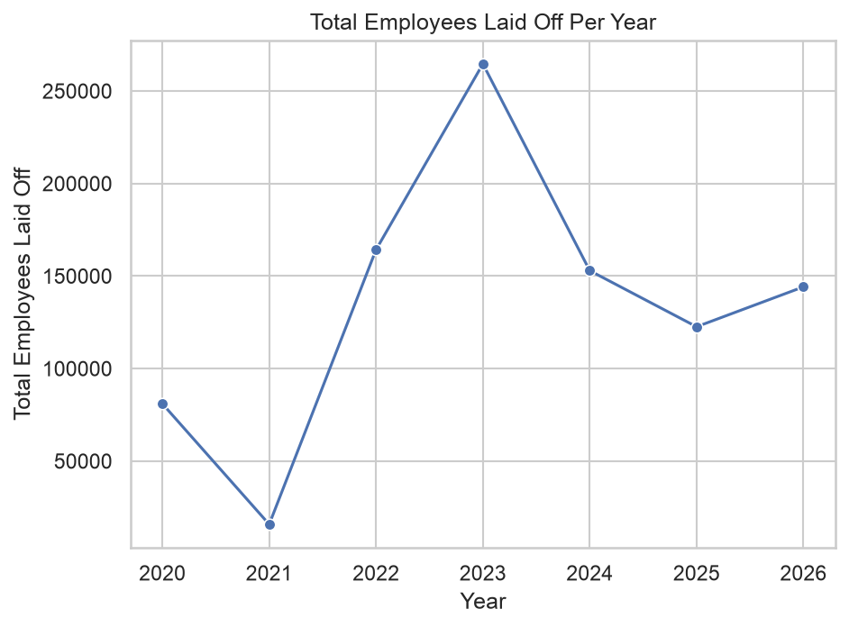

### 2. Which industries were most affected?

- Other recorded the highest total layoffs, followed by Retail and Hardware.
- Finance recorded the highest number of layoff events.
- Hardware ranked highly in total employees laid off but not in the top 10 by event count.

This demonstrates that the number of employees affected and the frequency of layoff events can produce different industry rankings.

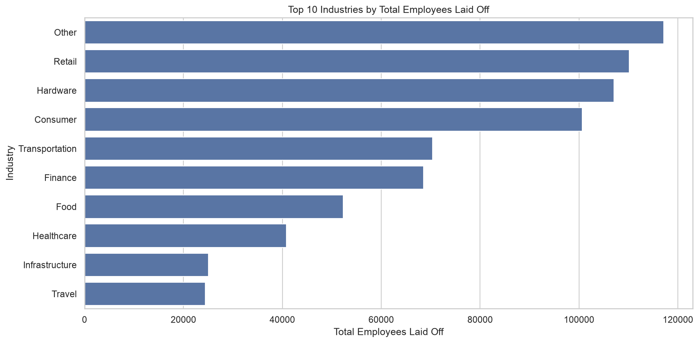

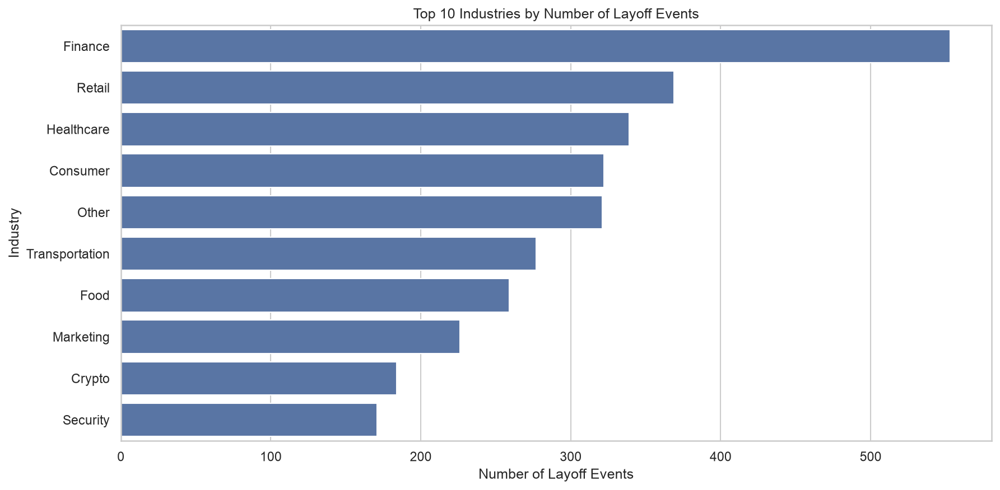

### 3. Which companies laid off the most employees?

The top companies by recorded layoffs included:

1. Amazon – 59,810
2. Intel – 43,167
3. Meta – 35,700
4. Microsoft – 35,355
5. Dell – 23,650
6. Oracle – 22,294
7. Cisco – 18,521
8. Salesforce – 16,744
9. Tesla – 14,500
10. Google – 13,749

The top 10 companies accounted for approximately **29.99%** of all known layoffs in the cleaned dataset.

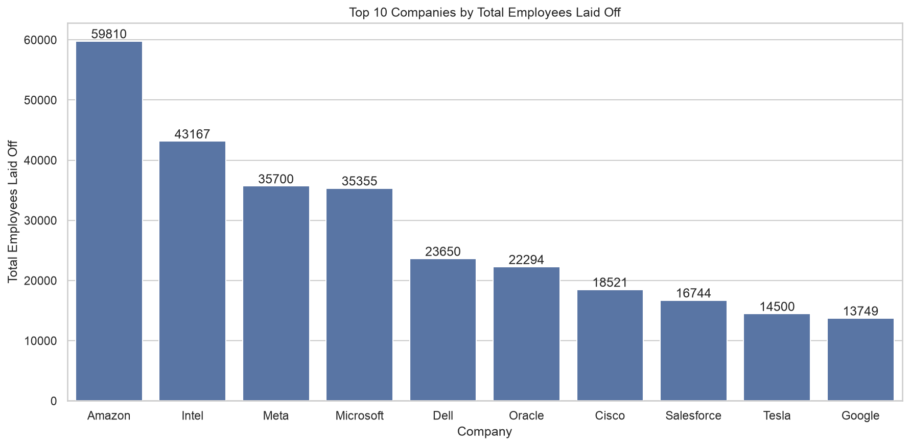

### 4. Which countries were most affected?

- United States: 669,839 layoffs, approximately **70.9%**.
- India: 69,939 layoffs, approximately **7.4%**.

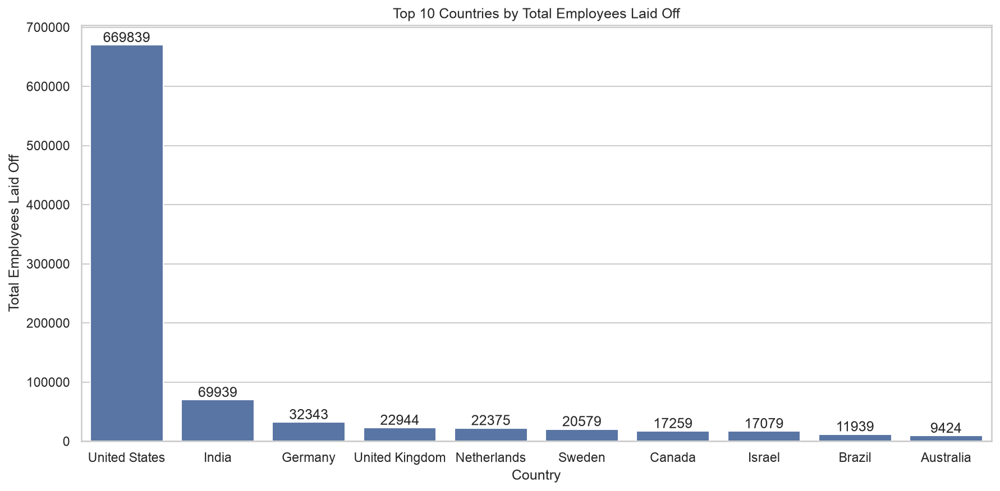

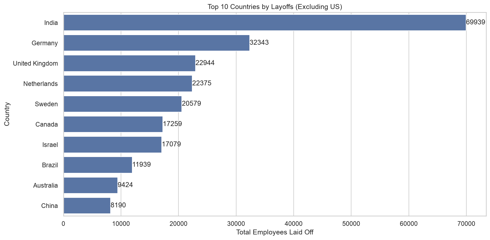

### 5. Does company stage matter?

- Series I had the highest median layoffs at 300.
- Series J followed at 250.
- Post-IPO companies had a median of 200 across 1,140 recorded events.
- Seed companies had the lowest median at 29.5.

Median layoffs were calculated using records with known layoff counts, while recorded event totals include all events. Some stages have relatively few records, so their medians should be interpreted cautiously.

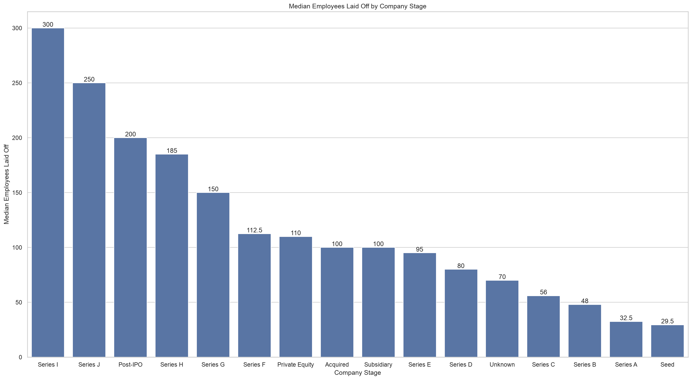

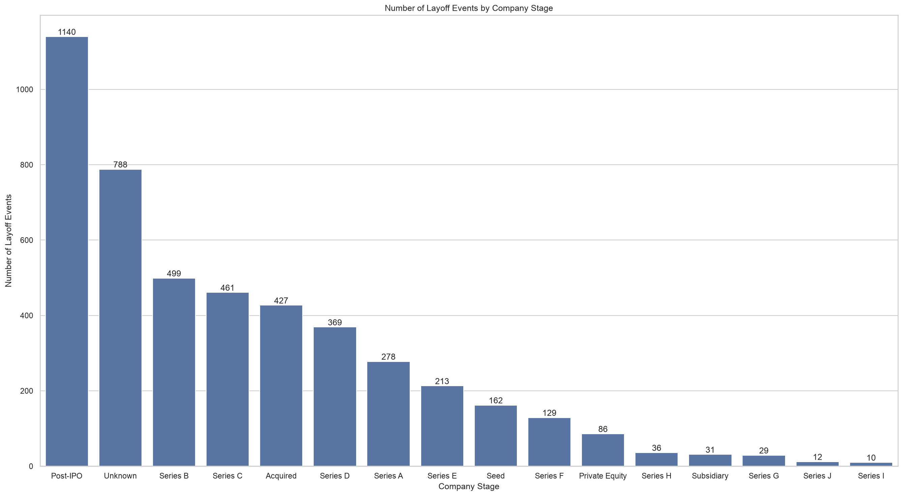

### 6. How large were layoffs relative to company size?

- 381 records showed a complete shutdown, where 100% of employees were laid off.
- This represented approximately **13.1% of records with a known layoff percentage**.

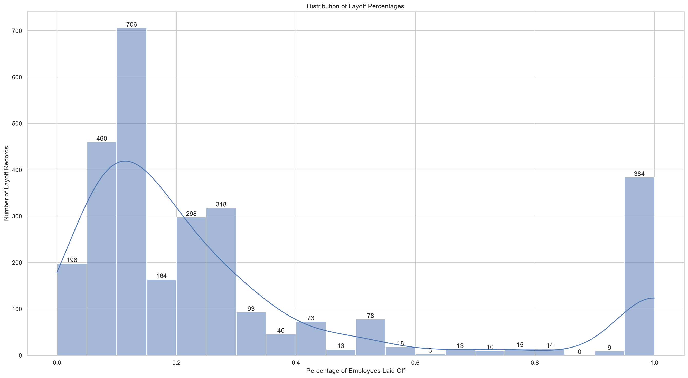

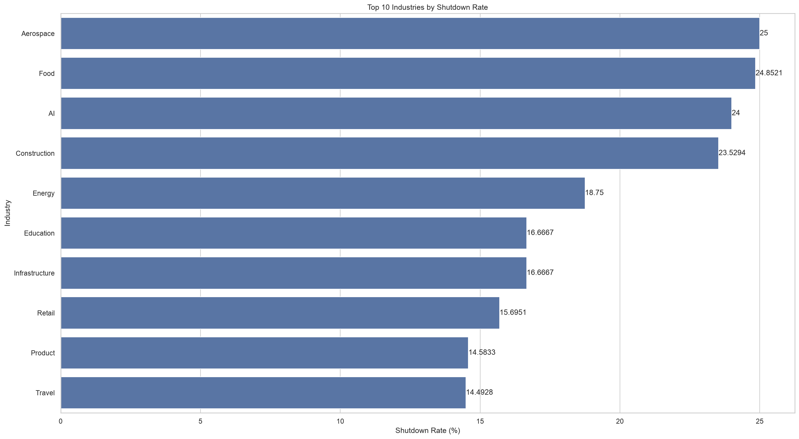

### 7. Is company funding related to layoffs?

Two correlation measures were examined:

- **Pearson correlation: 0.1191** – a very weak positive linear relationship.
- **Spearman correlation: 0.40549** – a moderate positive monotonic relationship.

The difference suggests that the association may not be purely linear. Funding alone does not explain layoff size, and correlation does not imply causation.

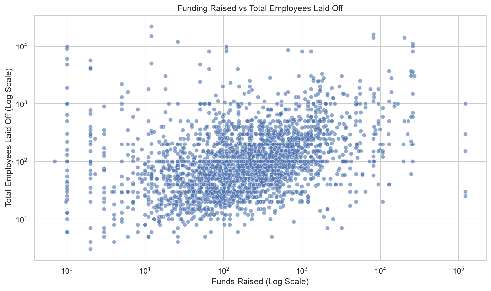

### 8. Are there monthly layoff patterns?

- January had the highest combined layoffs across 2021–2025.
- January ranked among the top three months in three of those five years: 2021, 2023, and 2024.
- November was second-highest, with 79,654 layoffs.
- September recorded the lowest total, with 19,239 layoffs.
- January 2023 contributed approximately 67.1% of all January layoffs during the five-year period.
- Without January 2023, the remaining January total would be 43,997, ranking 9th among the 12 months.

This shows that one unusually large month can influence the overall monthly pattern. The results do not establish a consistent seasonal trend.

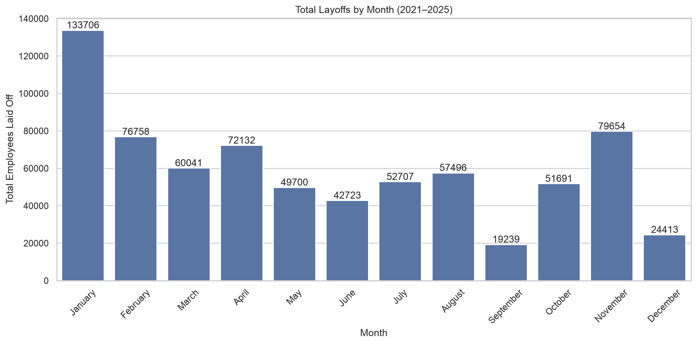

## Skills Demonstrated

- Data cleaning and preprocessing
- Handling missing values and duplicate records
- Exploratory Data Analysis (EDA)
- Data aggregation and grouping with Pandas
- Numerical analysis with NumPy
- Data visualization with Matplotlib and Seaborn
- Statistical reasoning and correlation analysis
- Git and GitHub version control
- Communicating analytical findings

## How to Run the Project

### 1. Clone the repository

```bash
git clone https://github.com/shreya7090/Tech-Layoffs-Analysis.git
cd Tech-Layoffs-Analysis
```

### 2. Create a virtual environment

```bash
python3 -m venv .venv
```

### 3. Activate the virtual environment

**macOS / Linux:**

```bash
source .venv/bin/activate
```

**Windows:**

```bash
.venv\Scripts\activate
```

### 4. Install dependencies

```bash
pip install -r requirements.txt
```

### 5. Download the dataset

Download the CSV from [Kaggle](https://www.kaggle.com/datasets/swaptr/layoffs-2022) and place it at:

```text
data/raw/layoffs.csv
```

### 6. Run the notebooks in order

Start Jupyter Notebook:

```bash
jupyter notebook
```

Run the notebooks in this order:

1. `01_data_understanding.ipynb`
2. `02_data_cleaning.ipynb`
3. `03_exploratory_analysis.ipynb`

The data-cleaning notebook creates the cleaned dataset required by the exploratory analysis notebook.

## Limitations

- **Missing layoff counts:** 1,626 of 4,670 records (approximately 34.8%) do not contain a known employee layoff count. These values were deliberately not imputed.
- **Partial years:** 2020 and 2026 do not represent complete calendar years.
- **Industry classification:** Other is a catch-all category.
- **Small samples:** Some company stages and industries have relatively few records.
- **Funding correlation:** Pearson correlation was calculated on skewed data. The `funds_raised` variable is measured in USD millions. Correlation does not establish causation.
- **Dataset coverage:** The dataset represents recorded layoff events and may not capture every real-world layoff.

## Detailed Findings

For the complete methodology, analysis, visualizations, limitations, and conclusions, see [reports/findings.md](reports/findings.md).

## Acknowledgements

- [Layoffs.fyi](https://layoffs.fyi/) for tracking technology layoff information.
- [Kaggle dataset by Swaptr](https://www.kaggle.com/datasets/swaptr/layoffs-2022) for providing the dataset used in this project.

---

**Author:** Shreya Patil  
**Project:** Technology Layoffs Analysis