# Technology Layoffs Analysis – Findings Report

## 1. Executive Summary

This project analyzes global technology layoff records from March 2020 to November 2026 to identify trends across years, industries, companies, countries, company stages, and funding levels.

Three important findings stand out:

- **2023 was the peak year:** 264,660 employees were laid off in records with a known count; 1,389 layoff events were recorded in total.
- **The United States accounted for approximately 70.9%** of known recorded layoffs.
- **2026 had already exceeded 2025:** 144,171 known layoffs were recorded through November 11, 2026, compared with 122,606 in the full year 2025. This is approximately 17.6% higher, even though 2026 is a partial year.

The analysis also found that a relatively small group of companies accounted for a substantial share of layoffs, industries ranked differently by layoff totals and event counts, and the apparent January pattern was heavily influenced by January 2023.

## 2. Data and Methodology

### 2.1 Dataset Source and Description

The dataset was obtained from the [Technology Layoffs Dataset on Kaggle](https://www.kaggle.com/datasets/swaptr/layoffs-2022), with Layoffs.fyi credited as the original data source.

**Dataset details:**

- Original records: 4,675
- Cleaned records: 4,670
- Date range: March 2020 to November 2026
- Coverage: Global technology company layoff events

The dataset contains information about companies, locations, countries, industries, layoff dates, employees laid off, percentage of employees laid off, funds raised, and company stages.

### 2.2 Data Cleaning

The raw dataset was examined and cleaned before exploratory analysis.

The main cleaning steps included:

1. Converted date columns into appropriate datetime formats.
2. Standardized country names, including replacing UAE with United Arab Emirates.
3. Filled 2 missing country values where the country could be identified.
4. Filled 2 missing industry values where the industry could be identified.
5. Filled 8 missing company-stage values with `Unknown`.
6. Removed 5 duplicate records, reducing the dataset from 4,675 to 4,670 records.
7. Created a `size_known` indicator to distinguish records with known layoff counts from records with missing counts.
8. Saved the cleaned dataset as `data/cleaned/layoffs_cleaned.csv`.

Missing employee layoff counts were deliberately not filled. Estimating these values without reliable evidence could introduce misleading results.

### 2.3 Exploratory Analysis

The analysis was organized around eight questions:

1. How have layoffs changed over time?
2. Which industries were most affected?
3. Which companies laid off the most employees?
4. Which countries were most affected?
5. Does company stage matter?
6. How large were layoffs relative to company size?
7. Is company funding related to layoffs?
8. Are there monthly layoff patterns?

The analysis used Pandas for data manipulation, NumPy for numerical operations, Matplotlib and Seaborn for visualization, and correlation measures for statistical analysis.

## 3. Key Findings

### 3.1 Layoffs Over Time

The yearly analysis showed a substantial increase in recorded layoffs during 2023.

- 2023 recorded **264,660 employees laid off in records with a known count**.
- **1,389 layoff events were recorded in total** during 2023, including events without a known layoff count.
- January 2023 alone recorded 89,709 known layoffs.
- By November 11, 2026, the dataset recorded 144,171 known layoffs.
- The full year 2025 recorded 122,606 known layoffs.

The 2026 total was approximately 17.6% higher than the 2025 total:

`(144,171 − 122,606) ÷ 122,606 × 100 ≈ 17.6%`

However, 2026 is a partial year, so this comparison should not be interpreted as a complete-year comparison.

**Interpretation:** The data shows that 2023 was a major peak in recorded layoffs. The 2026 figure is notable, but it only covers records available through November 11.

**Visualizations:**

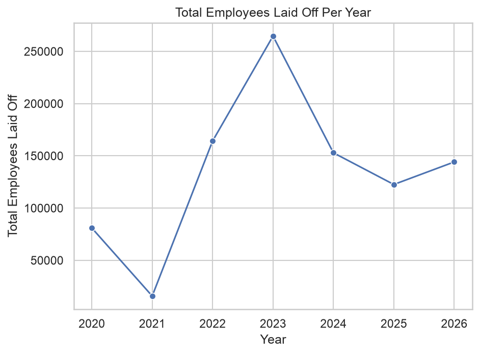

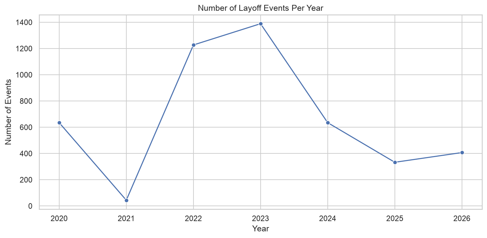

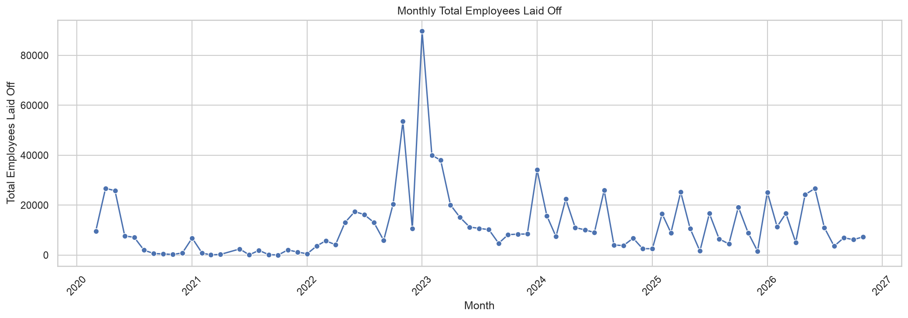

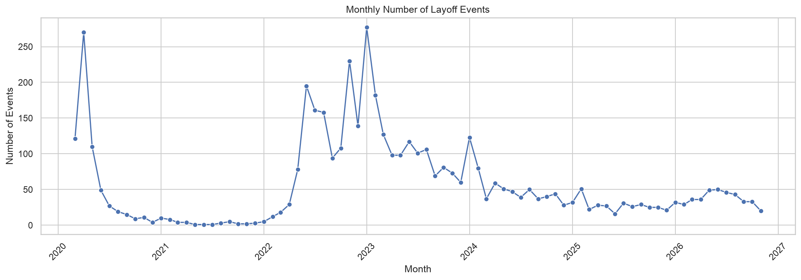

### 3.2 Industries Most Affected

The industry analysis compared total employees laid off with the number of recorded layoff events.

The highest total layoffs were recorded in:

| Industry | Employees laid off |
|---|---:|
| Other | 117,130 |
| Retail | 110,158 |
| Hardware | 107,032 |
| Consumer | 100,625 |
| Transportation | 70,353 |
| Finance | 68,531 |

Finance recorded the highest number of layoff events, with 553 events.

Other industries with high event counts included Retail, Healthcare, Consumer, and Transportation.

**Interpretation:** Total layoffs and event counts measure different things. Hardware ranked among the highest industries by employees affected, while Finance had the highest number of events. This suggests that industries can experience different patterns of layoff frequency and scale.

The Other category is a catch-all classification and should be interpreted cautiously.

**Visualizations:**

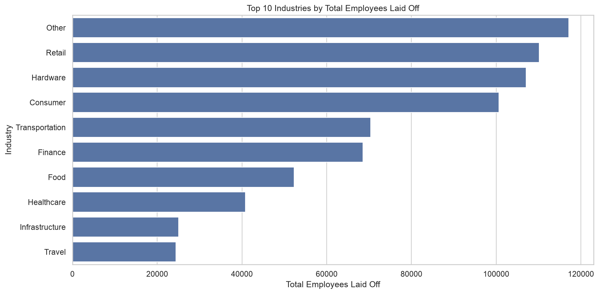

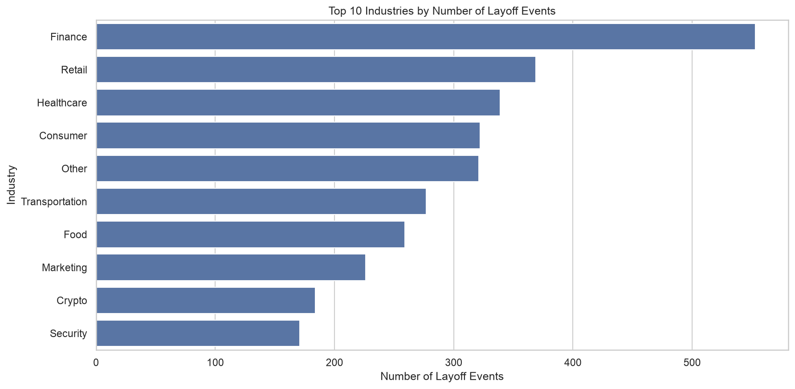

### 3.3 Companies With the Highest Layoffs

The top companies by total recorded employees laid off were:

| Rank | Company | Employees laid off |
|---:|---|---:|
| 1 | Amazon | 59,810 |
| 2 | Intel | 43,167 |
| 3 | Meta | 35,700 |
| 4 | Microsoft | 35,355 |
| 5 | Dell | 23,650 |
| 6 | Oracle | 22,294 |
| 7 | Cisco | 18,521 |
| 8 | Salesforce | 16,744 |
| 9 | Tesla | 14,500 |
| 10 | Google | 13,749 |

The top 10 companies accounted for approximately **29.99% of all known layoffs** in the cleaned dataset.

**Interpretation:** A substantial proportion of recorded layoffs was concentrated among a relatively small group of large technology companies.

**Visualization:**

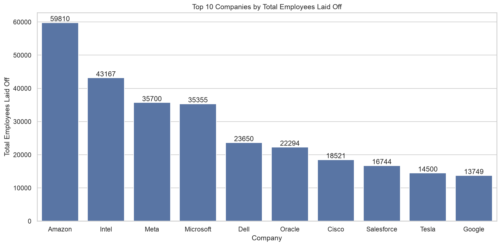

### 3.4 Countries Most Affected

The country analysis showed that the United States accounted for the largest share of recorded layoffs.

| Country | Employees laid off | Share |
|---|---:|---:|
| United States | 669,839 | 70.9% |
| India | 69,939 | 7.4% |

The United States accounted for approximately 70.9% of the total known layoffs, while India accounted for approximately 7.4%.

**Interpretation:** The recorded layoffs were heavily concentrated in the United States. These percentages describe the dataset's recorded layoffs and should not be interpreted as the proportion of all real-world layoffs in each country.

**Visualizations:**

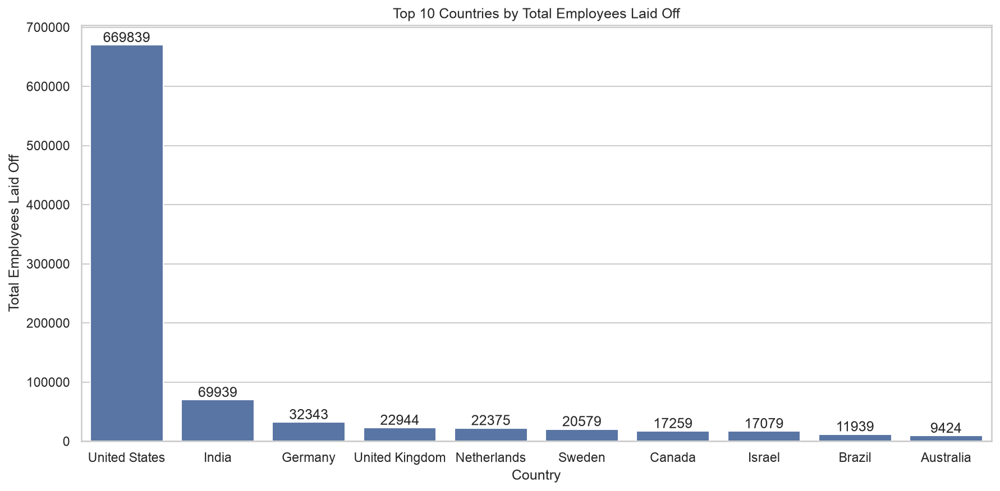

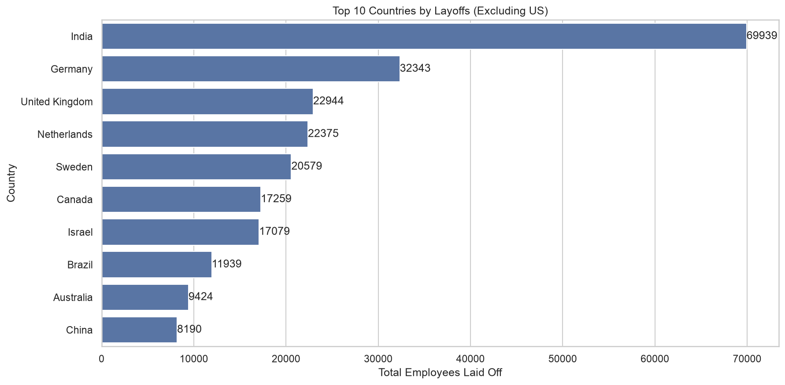

### 3.5 Layoffs Across Company Stages

The company-stage analysis compared the median number of employees laid off per recorded event.

| Company stage | Median employees laid off | Recorded events (all) |
|---|---:|---:|
| Series I | 300 | 10 |
| Series J | 250 | 12 |
| Post-IPO | 200 | 1,140 |
| Seed | 29.5 | 162 |

**Important:** Median layoffs were calculated using only records with known layoff counts. The recorded event counts in the table include all events, including those with missing layoff counts. Therefore, the sample size used to calculate each median is smaller than or equal to the corresponding event count.

Series I had the highest median layoffs, followed by Series J and Post-IPO companies. Seed-stage companies had the lowest median.

**Interpretation:** Layoffs occur across different stages of company development. The higher median values for Series I and Series J should be interpreted cautiously because their sample sizes are small. Post-IPO companies provide a larger number of recorded events for comparison.

**Visualizations:**

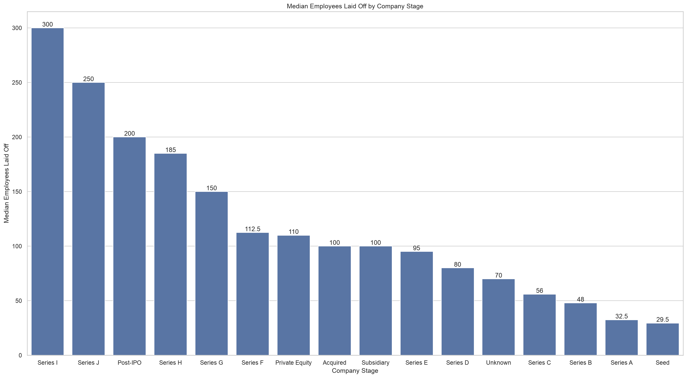

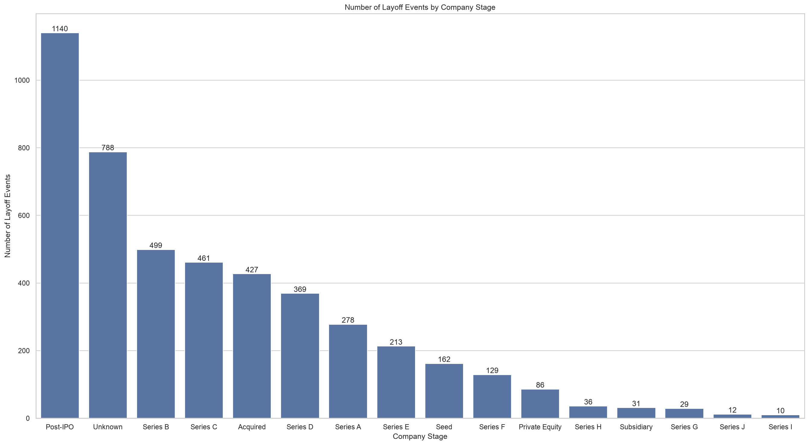

### 3.6 Layoff Severity and Company Shutdowns

The percentage of employees laid off was used to examine the severity of workforce reductions.

A record with `percentage_laid_off = 1.0` represents a complete workforce layoff or shutdown in the dataset.

Key findings:

- 381 records showed 100% layoffs.
- There were 2,913 records with a known layoff percentage.
- Complete-shutdown records represented approximately **13.1%** of those records.
- The median recorded layoff percentage was approximately 17%.
- The 75th percentile was approximately 33%.

**Interpretation:** Complete workforce layoffs represent a meaningful portion of records with known layoff percentages. However, the shutdown rate is based on recorded events, not necessarily unique companies.

**Visualizations:**

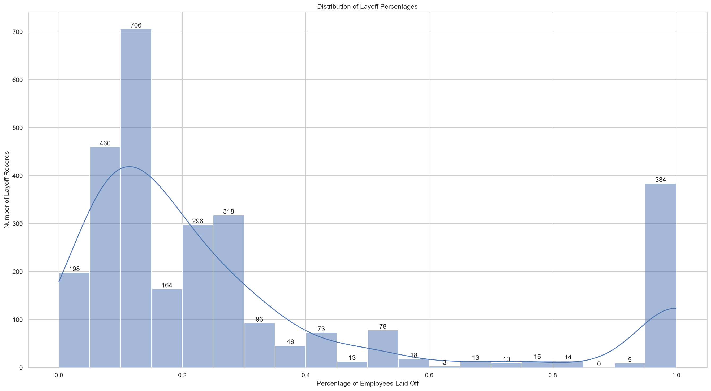

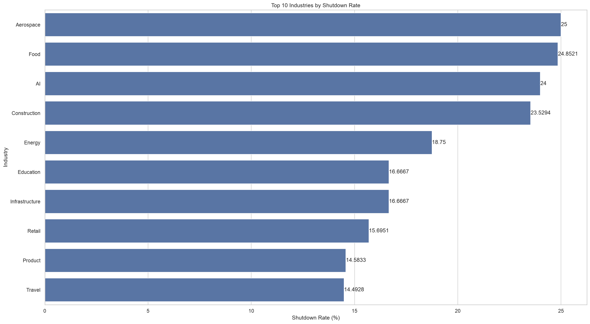

### 3.7 Relationship Between Company Funding and Layoffs

The relationship between company funding and the number of employees laid off was examined using a scatter plot and two correlation measures.

The `funds_raised` variable is measured in USD millions.

The calculated correlations were:

| Correlation method | Correlation value | Interpretation |
|---|---:|---|
| Pearson | 0.1191 | Very weak positive linear relationship |
| Spearman | 0.40549 | Moderate positive monotonic relationship |

Pearson correlation measures the strength of a linear relationship, while Spearman correlation measures the strength of a monotonic relationship using ranked values.

**Interpretation:**

- Pearson's value indicates a very weak positive linear association.
- Spearman's higher value indicates a stronger positive association when comparing the rankings of funding and layoffs.
- The difference suggests that the association may not be purely linear.
- One possible explanation is company size: larger companies may have raised more funding and also have larger workforces, creating the potential for larger layoff counts. This is a possible explanation, not a conclusion established by this analysis.
- Funding alone does not explain the number of employees laid off.

These are associations, not evidence that higher funding causes higher layoffs. The data is also skewed, which should be considered when interpreting correlation results.

**Visualization:**

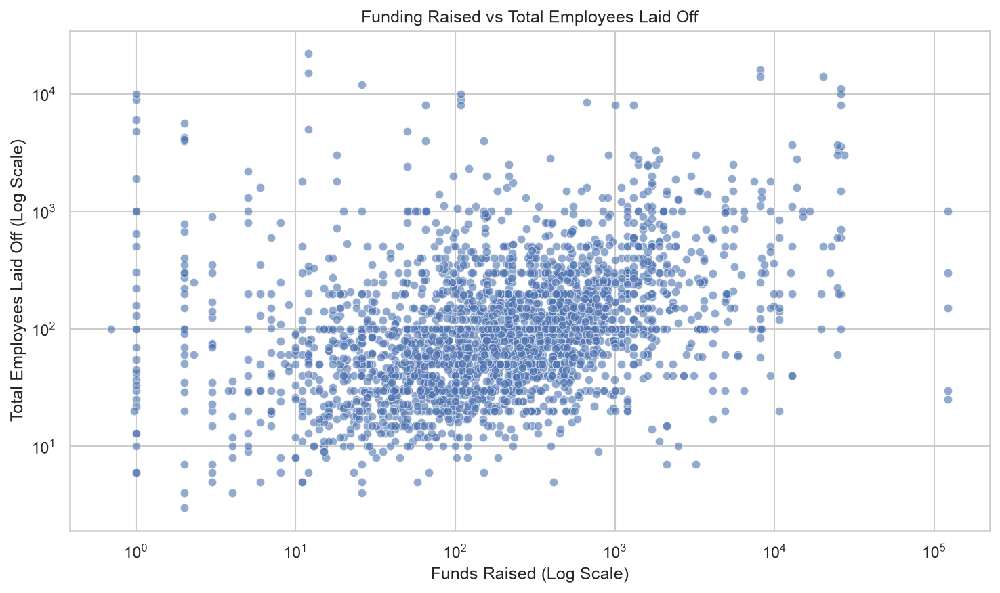

### 3.8 Monthly Layoff Patterns

Monthly layoffs were analyzed across the complete years 2021 to 2025 to reduce the effect of incomplete calendar years.

The combined monthly totals showed:

| Month | Employees laid off |
|---|---:|
| January | 133,706 |
| November | 79,654 |
| February | 76,758 |
| April | 72,132 |
| March | 60,041 |
| August | 57,496 |
| July | 52,707 |
| October | 51,691 |
| May | 49,700 |
| June | 42,723 |
| December | 24,413 |
| September | 19,239 |

January recorded the highest combined layoffs, followed by November. September recorded the lowest total.

January ranked among the top three months in 3 of the 5 years analyzed: 2021, 2023, and 2024.

However, January 2023 alone contributed 89,709 layoffs, approximately 67.1% of all January layoffs across the five-year period.

Without January 2023:

`133,706 − 89,709 = 43,997`

The remaining January total of 43,997 would rank **9th among the 12 months**, below February, April, and November.

**Interpretation:** The high combined January figure is strongly influenced by one unusually large month. Therefore, the data does not establish a consistent seasonal pattern in technology layoffs.

**Visualization:**

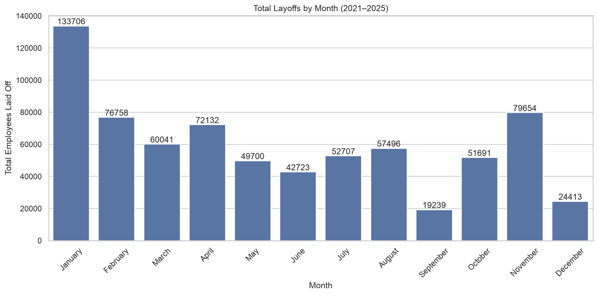

## 4. Limitations

The findings should be interpreted with the following limitations in mind:

1. **Missing layoff counts:** 1,626 out of 4,670 records, approximately 34.8%, do not contain a known employee layoff count. These values were deliberately not imputed.
2. **Incomplete calendar years:** 2020 and 2026 are partial years, so their totals cannot be directly compared with complete calendar years without qualification.
3. **Industry classification:** The Other category groups companies that do not fit the available industry classifications.
4. **Small sample sizes:** Some company stages and industries have relatively few records. Their medians and rates may be less stable.
5. **Skewed data:** Layoff counts and funding amounts are not necessarily normally distributed. Pearson correlation measures linear association and may not capture all patterns.
6. **Funding measurement:** The `funds_raised` column is measured in USD millions. Correlation does not establish causation.
7. **Dataset coverage:** The dataset contains recorded layoff events and may not represent every technology layoff worldwide.
8. **Event-level analysis:** Multiple records can relate to the same company. A recorded event should not automatically be treated as a unique company.

## 5. Conclusion

This analysis highlights several important patterns in recorded global technology layoffs.

First, layoffs were concentrated among a relatively small group of large companies. The top 10 companies accounted for approximately 29.99% of all known layoffs, while the United States accounted for approximately 70.9%.

Second, industries ranked differently depending on whether the analysis measured employees affected or the number of layoff events. Finance had the highest event count, while Hardware ranked among the highest in total layoffs. This shows why both measures are important.

Third, monthly totals can be misleading when one unusually large month dominates the results. January appeared to have the highest combined layoffs, but January 2023 contributed approximately 67.1% of the total January layoffs across 2021–2025. Without that month, January would rank 9th among the 12 months. This does not establish a reliable seasonal pattern.

The funding analysis also showed that the relationship depends on the correlation method: Pearson indicated a very weak linear relationship, while Spearman indicated a moderate monotonic association. Funding alone cannot explain layoff size.

Overall, the project demonstrates how data cleaning, exploratory analysis, visualization, and statistical reasoning can be combined to investigate a real-world business problem.

## 6. Future Work

The project can be extended through:

- SQL queries for deeper data exploration and more complex aggregations.
- An interactive Power BI dashboard for exploring layoffs by company, industry, country, and year.
- More detailed statistical analysis of funding, company stage, and layoff severity.
- Additional analysis of unique companies versus individual layoff events.
- Regular dataset updates to track future layoff trends.

## 7. Tools Used

- Python
- Pandas
- NumPy
- Matplotlib
- Seaborn
- Jupyter Notebook
- Git and GitHub

## 8. References

- [Kaggle – Layoffs Dataset by Swaptr](https://www.kaggle.com/datasets/swaptr/layoffs-2022)
- [Layoffs.fyi](https://layoffs.fyi/)

